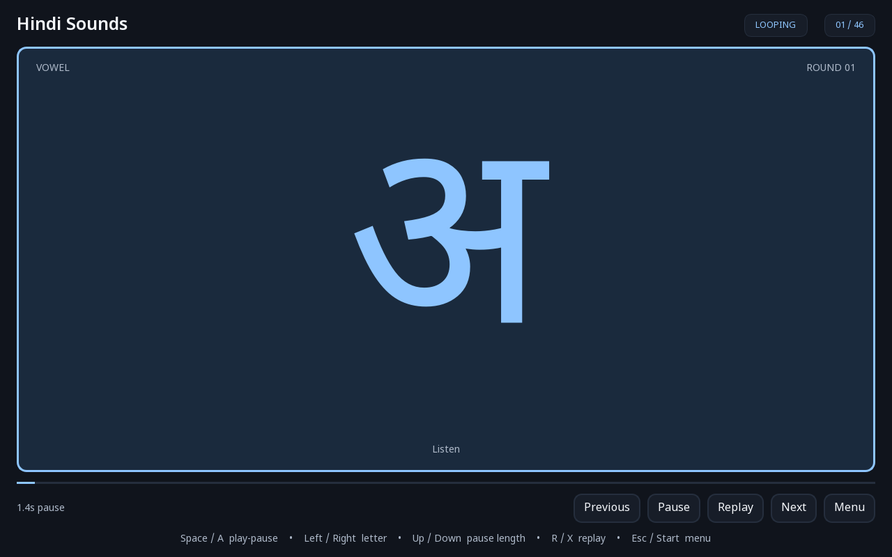

# Hindi Sounds

An offline Windows app for practicing Hindi letter sounds. Each letter appears with its recorded pronunciation, a synchronized blue highlight, and a continuous alphabet loop. No vocabulary, translations, or romanization appears on the practice screen.

## Launch

Download **Hindi-Sounds-Windows.zip** from the [latest release](https://github.com/shaggyga/hindi-sounds/releases/latest), extract the entire archive, and open **Hindi Sounds.exe** inside the extracted folder. Keep the `_internal` folder beside the executable. Python is not required. The app stores its progress and settings in `%LOCALAPPDATA%/HindiSoundsApp`.

The packaged release targets Windows 10/11, 64-bit. A local source build places the executable at `release/Hindi Sounds/Hindi Sounds.exe`.

The home menu has Start/Resume, Restart, Playback settings, Display settings, Controls, and audio credits. Playback settings include letter group, pause between recordings, and volume. Display supports windowed, borderless, and full screen.

## Controls

- Space / controller A: play or pause.
- Left / right or D-pad: previous / next letter.
- Up / down: longer / shorter pause after the sound.
- R / controller X: replay.
- Esc / Start: menu.
- F1 / View: help.
- F11: cycle window modes.
- In menus use arrows / D-pad, Enter / A, and Esc / B.

The app opens paused at the menu. Opening a menu or minimizing pauses playback. Resume repeats the current letter from its beginning. Each sound finishes before the pause and next letter; the sequence wraps automatically. Controller input is accepted only while this app is active.

## Content

46 core characters: 11 independent vowels, two vowel signs, and 33 basic consonants. Additional nukta letters and conjuncts are not included in this introductory collection. Audio is bundled from Mansi Bajaj / University of Texas, CC BY 4.0; credits and modification details are in `THIRD_PARTY_NOTICES.md`.

## Separate video

[Hindi-Sounds.mp4](https://github.com/shaggyga/hindi-sounds/releases/latest/download/Hindi-Sounds.mp4) is a separate 1080p video with one full pass through the same 46 sounds. It is also included at `video/Hindi-Sounds.mp4` in this repository. Use your video player's loop setting for repeated viewing.

## Development

Requires Python 3.12 or 3.13. Install `requirements-build.txt`, run `python -m hindi_sounds.main`, test with `python -m pytest tests`, and package with `python -m PyInstaller --noconfirm --workpath build --distpath release HindiSounds.spec`.

`--smoke-test REPORT_JSON` runs actual bundled audio decoding with volume at zero, checks the final two sounds and wrap to the first, and exits with a report. `--screenshot-dir PATH` captures the practice/menu states. Both use isolated temporary settings. `--windowed` overrides the saved screen mode for the launch.

The packaging spec excludes unrelated ICU DLLs from other programs, so Qt uses Windows' system ICU. This prevents the QtCore startup error described in `reports/packaging-diagnosis.md`. `python reports/check_bundle.py` checks this isolation and all 46 bundled recordings.

## Verification

29 automated playback and interface tests passed. The packaged executable passed real audio decoding and loop-wrap checks; packaged screenshots verified the font and layout. The MP4's 46 image/audio pairs passed synchronization and full-decode checks. A physical controller has not been tested.
